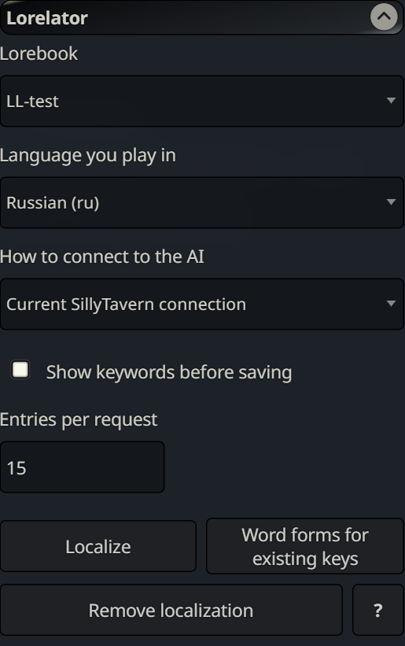
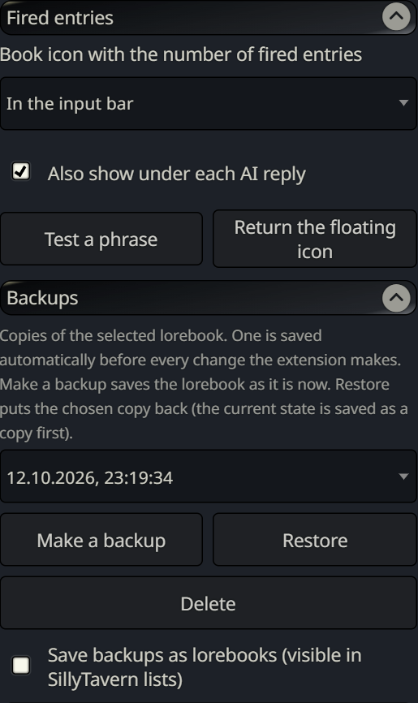
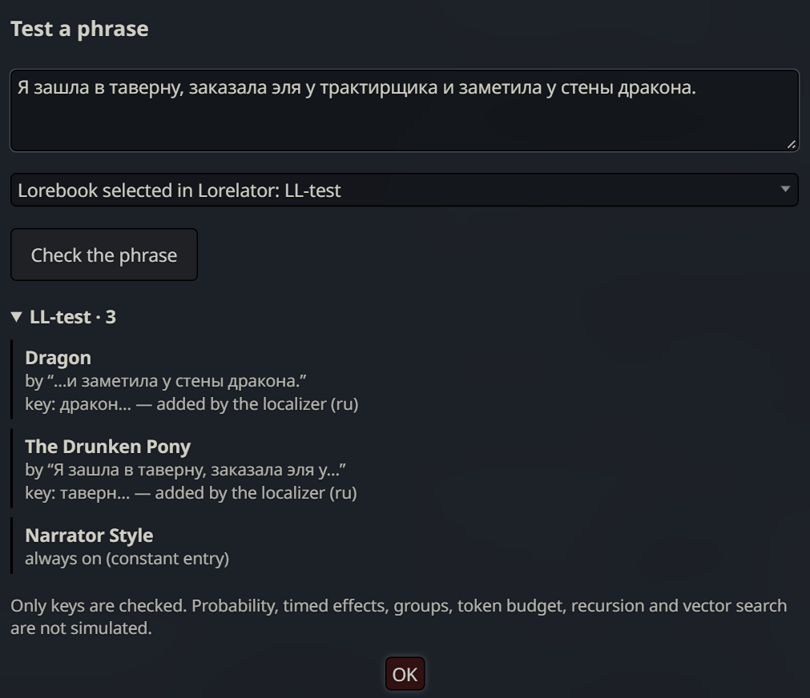

# Lorelator

**English** | [Русский](README.ru.md)


A SillyTavern extension for roleplaying in your own language with lorebooks written in another one, usually English.

Lorebook entries fire when one of their keys appears in the chat. If the keys are English and you play in Russian, Spanish or German, the entries never fire. Lorelator asks an AI model, once per entry, which words a speaker of your language would use for the subject. It turns the answers into keys that also catch other word forms and adds them next to the original keys. During play SillyTavern matches these keys on its own, so there are no extra requests and no waiting.

| Original key | You play in | Key added by Lorelator | Also catches |
|---|---|---|---|
| `tavern` | Russian | `таверн…` | таверна, таверну, в таверне |
| `tavern` | Spanish | `taberna…` | tabernas, tabernero |
| `dragon` | German | `Drache…` | Drachen, Drachens |
| `dragon` | Spanish | `dragón…` | dragones, dragon |

Behind each row is an ordinary regex key, for example `/(?<![\p{L}\p{N}])тав[её]рн\p{L}*/iu`. It is added to the entry, and the original keys stay untouched.

## Screenshots

<table>
  <tr>
    <td align="center"><br><sub>Main controls</sub></td>
    <td align="center"><br><sub>Fired entries and backups</sub></td>
  </tr>
</table>

<p align="center">
  <br>
  <sub>The phrase tester: a Russian message triggers the English-keyed entries through the keys Lorelator added.</sub>
</p>

## Features

- **Keys in your language.** Translations, transliterated names, synonyms, colloquial words and slang. Crude and adult vocabulary stays as it is: the prompt forbids replacing it with milder words. This was checked on DeepSeek, Gemini and Qwen.
- **Word forms.** A key written for one form also catches the others. For languages with complex endings the model lists one or two extra forms, such as the genitive and the plural.
- **Fewer wrong hits.** The model is shown the titles of the other entries in the lorebook, so it avoids words that belong to them.
- **Fired entries.** A book icon (in the input bar or floating) lists the entries that fired for the last reply and the word that triggered each one. Optionally the same list appears under every reply. The phrase tester shows what any text would trigger.
- **Safe changes.** Added keys are marked and can be removed with one button. A backup copy is made before every change.
- **Clear errors.** A wrong API key, an empty balance, an unknown model or a content filter each get a plain explanation. Errors that would repeat for every batch stop the run immediately.
- **Any model.** It works with the current SillyTavern connection, a saved connection profile or any OpenAI-compatible service.

## Supported languages

| Language | How word forms are produced |
|---|---|
| Russian, German, French, Spanish, Portuguese, Italian, Czech, Hungarian | Snowball stemmer, run locally |
| Ukrainian, Polish, Slovak | Word stems supplied by the AI model |
| Indonesian | No stemmer needed (nouns take endings only): the word itself is the stem. The AI adds derived forms such as `sihir` → `penyihir` |
| Japanese, Chinese | Not needed, keys match as substrings |

For Russian, Ukrainian, Polish, Czech, Hungarian, German and Indonesian the model also lists one or two forms that a stem alone would miss. Keys written in Latin script ignore accents, so `wiedzma` matches `wiedźma`.

On dictionary tests the keys catch about 99% of word forms in Russian and Ukrainian and 96% to 100% in the other measured languages. Method and numbers: [docs/morphology-eval.md](docs/morphology-eval.md).

## Installation

**From SillyTavern (recommended)**

1. Click the **Extensions** button in the top bar (the icon with three blocks).
2. Click **Install extension**.
3. Paste the repository address and press **Install just for me**:
   ```
   https://github.com/kreip-zero/SillyTavern-Lorelator
   ```
4. Reload the page. **Lorelator** appears in the list of extensions.

**Manually**

If the installer is unavailable, for example when the server has no git: download the repository as a ZIP (**Code** → **Download ZIP**), unpack it and place the folder in `SillyTavern/data/default-user/extensions/`. Restart SillyTavern afterwards.

**Updating:** Extensions → **Manage extensions**, then the update button next to Lorelator.

**Requirements**

- SillyTavern 1.12.14 or newer (tested on 1.19).
- A connection to an AI model: a Chat Completion API, a Connection Manager profile or your own OpenAI-compatible service.
- On iPhone and iPad, iOS 16.4 or newer: the regex keys use lookbehind.

## Usage

1. Open **Extensions → Lorelator**.
2. Pick the lorebook, the language you play in and how to connect to the AI:
   - **Current SillyTavern connection**: whatever is connected right now.
   - **Saved connection profile**: any Connection Manager profile. **Load models** lets you pick another model of the same service. The profile's preset is not used.
   - **Own service and API key**: OpenRouter, NanoGPT, DeepSeek, Qwen, GLM (Z.ai), Kimi, OpenAI, Mistral, Groq or any OpenAI-compatible address (LM Studio, Ollama and others). Requests go through the SillyTavern server. The key is stored in the SillyTavern settings as plain text.
3. Press **Localize**. Lorelator shows how many entries it will process and roughly how many tokens that takes, then works in batches. With **Show keywords before saving** you can untick words you do not want.

Other controls (the **?** button explains each of them in the app):

- **Word forms for existing keys**: free, no AI. Adds word-form matching to keys that are already in your language, for lorebooks you started translating by hand.
- **Remove localization**: removes the keys added for the selected language. Your own keys stay.
- **Backups**: create, restore or delete copies of the lorebook. Copies are hidden files by default and can be saved as regular lorebooks instead.

Running Localize again only processes new entries and entries edited since the last run. Always-on entries, disabled entries and entries without keys are skipped.

## Privacy and cost

Lorelator sends only its own prompt with the entries to the model. The chat, the character card and your preset are not included. The model is asked not to spend tokens on reasoning.

One entry takes roughly 300 to 600 input tokens and 250 to 550 output tokens. A lorebook of 200 entries costs a few cents on Flash-class models, paid once.

## Limitations

- Keys match the beginning of a word. German compounds (`Feuerdrache` for `Drache`) and some stem changes (`pes` → `psa`) can be missed unless the model listed that form.
- If the story only hints at a subject without any of the listed words, the entry does not fire.
- Reasoning ("thinking") models sometimes spend the whole token limit on reasoning and return nothing. Lorelator reports this and stops. Use a model without reasoning or turn it off.

## Development

```bash
npm install
npm test                       # Node 21+
npm run build:stemmers         # rebuild lib/snowball.js
node scripts/i18n-diff.mjs     # missing or stale Russian translations
```

## Support

Found a bug or have an idea? Open an [issue](https://github.com/kreip-zero/SillyTavern-Lorelator/issues). Include the lines from the browser console (F12) that start with `[Lorelator]`.

## License

[MIT](LICENSE) © kreip-zero. You may use, change and share the code freely as long as the author's name and the license text are kept. Word-form stemming uses [snowball-stemmers](https://www.npmjs.com/package/snowball-stemmers) (MIT).
