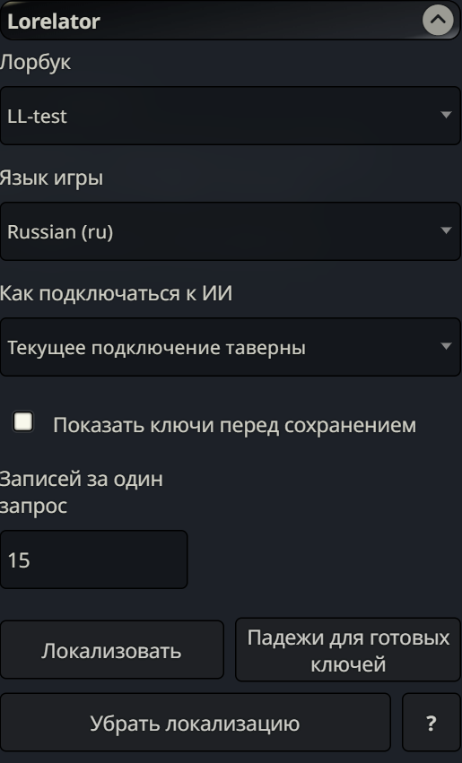
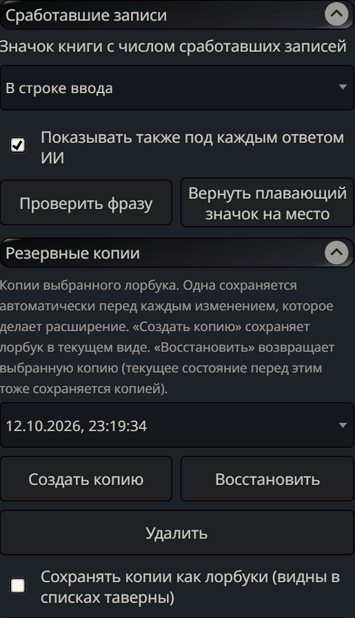
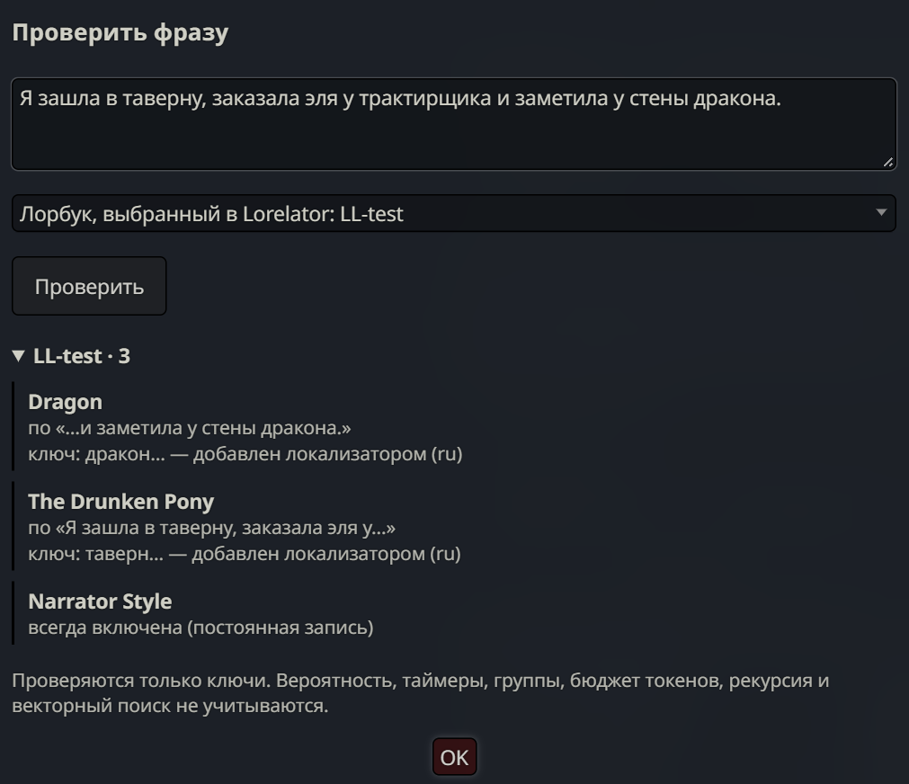

# Lorelator

[English](README.md) | **Русский**


Расширение для SillyTavern. Нужно тем, кто играет на своём языке, а лорбуки написаны на другом, чаще всего на английском.

Запись лорбука срабатывает, когда в чате встречается один из её ключей. Если ключи английские, а игра идёт на русском, испанском или немецком, записи не срабатывают никогда. Lorelator один раз на запись спрашивает у ИИ, какими словами о предмете говорят на вашем языке. Из ответов он делает ключи, которые ловят и другие формы слова, и добавляет их к исходным. Во время игры ключи проверяет сама SillyTavern, поэтому лишних запросов и задержек нет.

| Исходный ключ | Язык игры | Ключ от Lorelator | Ловит также |
|---|---|---|---|
| `tavern` | русский | `таверн…` | таверна, таверну, в таверне |
| `tavern` | испанский | `taberna…` | tabernas, tabernero |
| `dragon` | немецкий | `Drache…` | Drachen, Drachens |
| `dragon` | испанский | `dragón…` | dragones, dragon |

За каждой строкой стоит обычный regex-ключ, например `/(?<![\p{L}\p{N}])тав[её]рн\p{L}*/iu`. Он добавляется в запись, а исходные ключи остаются нетронутыми.

## Скриншоты

<table>
  <tr>
    <td align="center"><br><sub>Основные настройки</sub></td>
    <td align="center"><br><sub>Сработавшие записи и резервные копии</sub></td>
  </tr>
</table>

<p align="center">
  <br>
  <sub>Проверка фразы: русское сообщение запускает записи с английскими ключами через ключи, добавленные Lorelator.</sub>
</p>

## Возможности

- **Ключи на вашем языке.** Переводы, имена в транслитерации, синонимы, разговорные слова и сленг. Грубая и откровенная лексика остаётся как есть: промпт запрещает заменять её мягкими словами. Проверено на DeepSeek, Gemini и Qwen.
- **Формы слов.** Ключ, написанный для одной формы, ловит и остальные. Для языков со сложными окончаниями модель называет ещё одну-две формы, например родительный падеж и множественное число.
- **Меньше ложных срабатываний.** Модель видит названия остальных записей лорбука и избегает слов, которые относятся к ним.
- **Сработавшие записи.** Значок книги (в строке ввода или плавающий) показывает, какие записи сработали на последний ответ и из-за какого слова. По желанию тот же список выводится под каждым ответом. Проверка фразы показывает, что запустит любой текст.
- **Безопасные изменения.** Добавленные ключи помечаются, и их можно убрать одной кнопкой. Перед каждым изменением делается резервная копия.
- **Понятные ошибки.** Неверный API-ключ, пустой баланс, неизвестная модель и фильтр контента получают отдельные объяснения. Ошибка, которая повторилась бы на каждой пачке, сразу останавливает запуск.
- **Любая модель.** Работает с текущим подключением SillyTavern, сохранённым профилем или любым OpenAI-совместимым сервисом.

## Поддерживаемые языки

| Язык | Как получаются формы слов |
|---|---|
| Русский, немецкий, французский, испанский, португальский, итальянский, чешский, венгерский | Стеммер Snowball, работает локально |
| Украинский, польский, словацкий | Основы слов предоставляет ИИ |
| Индонезийский | Стеммер не нужен (у существительных только окончания): основой служит само слово. ИИ добавляет производные формы, например `sihir` → `penyihir` |
| Японский, китайский | Не нужны, ключи ищутся как подстроки |

Для русского, украинского, польского, чешского, венгерского, немецкого и индонезийского модель дополнительно называет одну-две формы, которые по одной основе не поймать. Ключи на латинице не учитывают диакритику: `wiedzma` найдёт `wiedźma`.

На словарных тестах ключи ловят около 99% форм слов в русском и украинском и от 96% до 100% в остальных проверенных языках. Методика и цифры: [docs/morphology-eval.md](docs/morphology-eval.md).

## Установка

**Через SillyTavern (рекомендуется)**

1. Нажмите кнопку **Расширения** (Extensions) в верхней панели, значок из трёх кубиков.
2. Нажмите **Установить расширение** (Install extension).
3. Вставьте адрес репозитория и нажмите **Установить только мне** (Install just for me):
   ```
   https://github.com/kreip-zero/SillyTavern-Lorelator
   ```
4. Обновите страницу. В списке расширений появится **Lorelator**.

**Вручную**

Если установщик недоступен, например на сервере нет git: скачайте репозиторий архивом (**Code** → **Download ZIP**), распакуйте и поместите папку в `SillyTavern/data/default-user/extensions/`. Затем перезапустите SillyTavern.

**Обновление:** Расширения → **Управление расширениями** (Manage extensions), кнопка обновления рядом с Lorelator.

**Требования**

- SillyTavern 1.12.14 или новее (проверено на 1.19).
- Подключение к ИИ: Chat Completion API, профиль Connection Manager или собственный OpenAI-совместимый сервис.
- На iPhone и iPad нужна iOS 16.4 или новее: regex-ключи используют lookbehind.

## Использование

1. Откройте **Расширения → Lorelator**.
2. Выберите лорбук, язык игры и способ подключения к ИИ:
   - **Текущее подключение SillyTavern**: то, что подключено сейчас.
   - **Сохранённый профиль подключения**: любой профиль Connection Manager. Кнопка **Загрузить модели** позволяет взять другую модель того же сервиса. Пресет профиля не используется.
   - **Свой сервис и API-ключ**: OpenRouter, NanoGPT, DeepSeek, Qwen, GLM (Z.ai), Kimi, OpenAI, Mistral, Groq или любой OpenAI-совместимый адрес (LM Studio, Ollama и другие). Запросы идут через сервер SillyTavern. Ключ хранится в настройках SillyTavern открытым текстом.
3. Нажмите **Локализовать**. Lorelator покажет, сколько записей будет обработано и примерно сколько это займёт токенов, а затем обработает их пачками. Если включить **Показать ключи перед сохранением**, лишние слова можно снять галочкой.

Остальные элементы (кнопка **?** в самом расширении объясняет каждый):

- **Падежи для готовых ключей**: бесплатно, без ИИ. Добавляет поиск по формам к ключам, которые уже на вашем языке. Подходит для лорбуков, которые вы начали переводить вручную.
- **Убрать локализацию**: удаляет ключи, добавленные для выбранного языка. Ваши собственные ключи остаются.
- **Резервные копии**: создание, восстановление и удаление копий лорбука. По умолчанию это скрытые файлы, но их можно сохранять и как обычные лорбуки.

Повторный запуск обрабатывает только новые записи и те, что менялись после прошлого запуска. Постоянные (constant) записи, отключённые записи и записи без ключей пропускаются.

## Приватность и стоимость

Lorelator отправляет модели только собственный промпт с записями. Чат, карточка персонажа и ваш пресет не передаются. Модель просят не тратить токены на рассуждения.

На одну запись уходит примерно 300–600 входных и 250–550 выходных токенов. Лорбук из 200 записей на моделях уровня Flash стоит несколько центов, и платить нужно один раз.

## Ограничения

- Ключи ищут начало слова. Немецкие составные слова (`Feuerdrache` для `Drache`) и некоторые чередования в основе (`pes` → `psa`) могут не сработать, если модель не назвала такую форму.
- Если в тексте предмет только подразумевается и ни одного слова из списка нет, запись не сработает.
- «Думающие» модели иногда тратят весь лимит токенов на рассуждения и ничего не возвращают. Lorelator сообщает об этом и останавливается. Используйте модель без рассуждений или отключите их.

## Разработка

```bash
npm install
npm test                       # Node 21+
npm run build:stemmers         # пересобрать lib/snowball.js
node scripts/i18n-diff.mjs     # недостающие или лишние русские переводы
```

## Поддержка

Нашли ошибку или есть идея? Создайте [issue](https://github.com/kreip-zero/SillyTavern-Lorelator/issues). Приложите строки из консоли браузера (F12), которые начинаются с `[Lorelator]`.

## Лицензия

[MIT](LICENSE) © kreip-zero. Код можно свободно использовать, изменять и распространять при условии, что сохранены имя автора и текст лицензии. Формы слов ищет [snowball-stemmers](https://www.npmjs.com/package/snowball-stemmers) (MIT).
